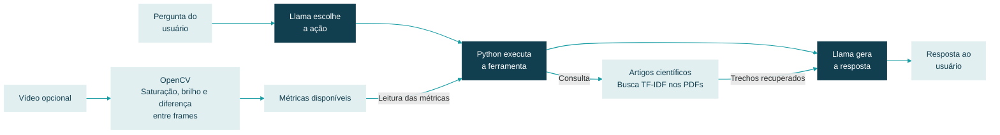

# Agente Simples (Inicial)

Agente desenvolvido como uma das entregas do 2º Challenge da Residência em IA. Sua função é fornecer explicações sobre as métricas visuais extraídas de um vídeo, consultando uma base de conhecimento por meio da técnica de **Retrieval-Augmented Generation (RAG)**.

## 🔄 Como o Agente Funciona

O fluxo de funcionamento do agente processa as solicitações do usuário integrando raciocínio de linguagem natural, execução de ferramentas em Python e recuperação de conhecimento em bases de dados locais.

## Estrutura dos arquivos

| Arquivo | Descrição |
|---|---|
| `Agente_Simples.ipynb` | Notebook com os códigos e funcionamento do agente inicial |
| `SensIA` | Slides da apresentação do dia 30/10 |

